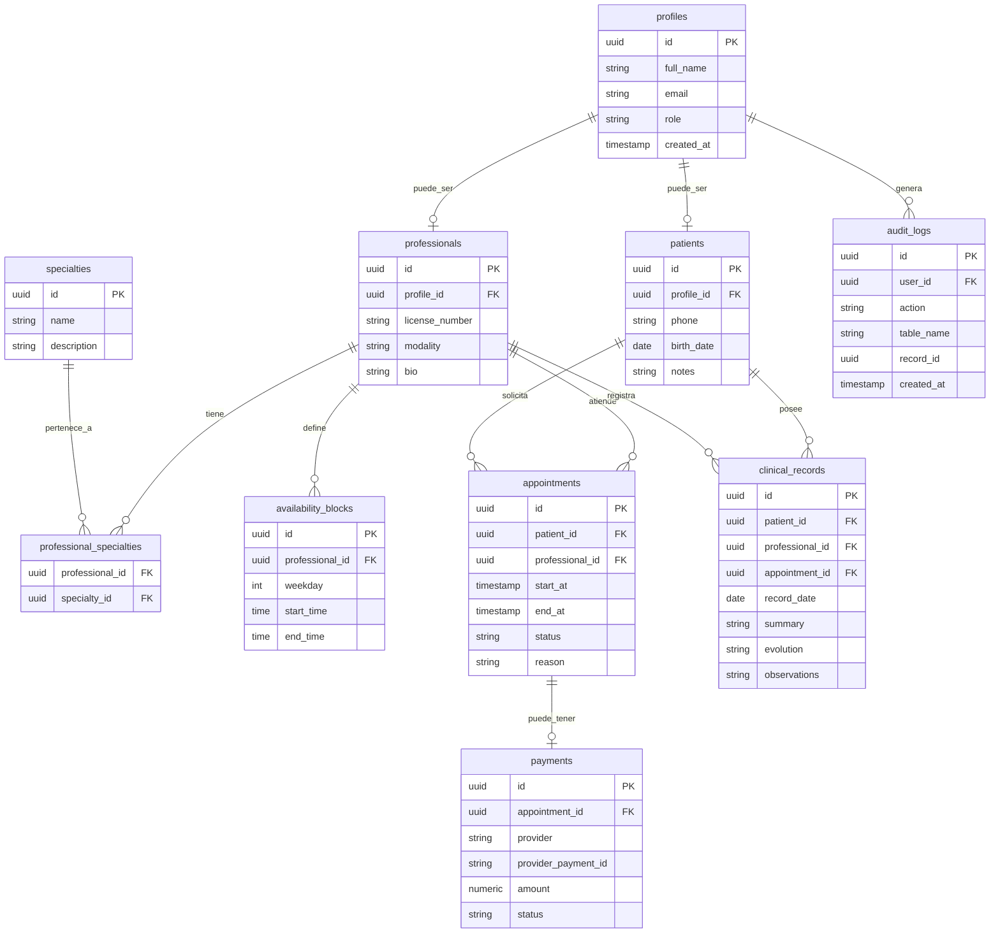

# Segunda Entrega: Diseño y Módulos

## 1. Introducción

En esta segunda entrega se presenta el diseño técnico inicial del sistema Mental Connection. El objetivo es definir el esquema de base de datos relacional y los módulos principales que serán desarrollados durante el proyecto.

Mental Connection utilizará una base de datos PostgreSQL mediante Supabase. El sistema estará compuesto por módulos relacionados con usuarios, pacientes, profesionales, turnos, pagos, disponibilidad horaria, registros clínicos y auditoría.

---

## 2. Arquitectura general del sistema

El sistema se desarrollará como una aplicación web utilizando React.js con TypeScript para el frontend y Supabase como Backend as a Service.

Supabase será utilizado para la autenticación de usuarios, base de datos PostgreSQL, políticas de seguridad, almacenamiento de datos y funciones serverless en caso de ser necesarias.

La arquitectura general estará compuesta por:

- Frontend web desarrollado con React.js y TypeScript.
- Supabase Auth para autenticación y gestión de usuarios.
- PostgreSQL mediante Supabase como base de datos relacional.
- Supabase Row Level Security para control de acceso a datos.
- Supabase Edge Functions para lógica del lado del servidor.
- Mercado Pago API para pagos o señas de turnos.

---

## 3. Modelo de base de datos

El sistema utilizará una base de datos relacional PostgreSQL mediante Supabase. Se eligió un modelo relacional porque permite representar de forma clara las relaciones entre usuarios, pacientes, profesionales, especialidades, turnos, pagos y registros clínicos.

Las tablas principales del sistema serán:

| Tabla | Nombre en español | Descripción |
|---|---|---|
| `profiles` | Perfiles | Almacena los datos generales de los usuarios registrados y su rol dentro del sistema. |
| `patients` | Pacientes | Almacena la información específica de los usuarios que cumplen el rol de paciente. |
| `professionals` | Profesionales | Almacena la información específica de los profesionales de salud mental. |
| `specialties` | Especialidades | Contiene las especialidades disponibles, como psicología, psiquiatría, psicopedagogía o fonoaudiología. |
| `professional_specialties` | Profesionales y especialidades | Relaciona profesionales con una o más especialidades. |
| `availability_blocks` | Bloques de disponibilidad | Registra los días y horarios disponibles de cada profesional. |
| `appointments` | Turnos | Almacena las reservas de turnos entre pacientes y profesionales. |
| `payments` | Pagos | Registra los pagos o señas asociados a los turnos mediante Mercado Pago. |
| `clinical_records` | Registros clínicos | Almacena el registro de atenciones o historia clínica básica asociada a cada paciente. |
| `audit_logs` | Auditorías | Registra acciones relevantes realizadas en el sistema, especialmente sobre datos sensibles. |

---
## 4. Diagrama entidad-relación

## 5. Descripción de tablas

### profiles

La tabla `profiles` almacena los datos generales de los usuarios registrados en el sistema. Se relaciona con el sistema de autenticación de Supabase y permite identificar el rol de cada usuario dentro de la plataforma.

Campos principales:

- `id`: identificador único del usuario.
- `full_name`: nombre completo del usuario.
- `email`: correo electrónico.
- `role`: rol del usuario dentro del sistema: paciente, profesional o administrador.
- `created_at`: fecha de creación del registro.

Relaciones:

- Un perfil puede estar asociado a un paciente.
- Un perfil puede estar asociado a un profesional.
- Un perfil puede generar registros de auditoría.

---

### patients

La tabla `patients` almacena la información específica de los pacientes. Cada paciente estará asociado a un usuario registrado en `profiles`.

Campos principales:

- `id`: identificador único del paciente.
- `profile_id`: referencia al perfil del usuario.
- `phone`: teléfono de contacto.
- `birth_date`: fecha de nacimiento.
- `notes`: notas generales administrativas.

Relaciones:

- Un paciente pertenece a un perfil.
- Un paciente puede tener varios turnos.
- Un paciente puede tener varios registros clínicos.

---

### professionals

La tabla `professionals` almacena la información específica de los profesionales vinculados a la salud mental y disciplinas afines.

Campos principales:

- `id`: identificador único del profesional.
- `profile_id`: referencia al perfil del usuario.
- `license_number`: número de matrícula o identificación profesional.
- `modality`: modalidad de atención, por ejemplo presencial, virtual o mixta.
- `bio`: descripción breve del profesional.

Relaciones:

- Un profesional pertenece a un perfil.
- Un profesional puede tener una o más especialidades.
- Un profesional puede definir varios bloques de disponibilidad.
- Un profesional puede atender varios turnos.
- Un profesional puede crear registros clínicos.

---

### specialties

La tabla `specialties` contiene las especialidades disponibles dentro del sistema.

Campos principales:

- `id`: identificador único de la especialidad.
- `name`: nombre de la especialidad.
- `description`: descripción breve de la especialidad.

Ejemplos de especialidades:

- Psicología.
- Psiquiatría.
- Psicopedagogía.
- Fonoaudiología.
- Terapia ocupacional.

Relaciones:

- Una especialidad puede estar asociada a varios profesionales.

---

### professional_specialties

La tabla `professional_specialties` es una tabla intermedia que relaciona profesionales con especialidades.

Se utiliza porque un profesional puede tener más de una especialidad y una especialidad puede pertenecer a varios profesionales.

Campos principales:

- `professional_id`: referencia al profesional.
- `specialty_id`: referencia a la especialidad.

Relaciones:

- Relaciona la tabla `professionals` con la tabla `specialties`.

---

### availability_blocks

La tabla `availability_blocks` almacena los bloques de disponibilidad horaria definidos por cada profesional.

Campos principales:

- `id`: identificador único del bloque de disponibilidad.
- `professional_id`: referencia al profesional.
- `weekday`: día de la semana.
- `start_time`: horario de inicio.
- `end_time`: horario de finalización.
- `is_active`: indica si el bloque se encuentra activo.

Relaciones:

- Un profesional puede tener varios bloques de disponibilidad.

---

### appointments

La tabla `appointments` almacena los turnos solicitados por los pacientes.

Campos principales:

- `id`: identificador único del turno.
- `patient_id`: referencia al paciente.
- `professional_id`: referencia al profesional.
- `start_at`: fecha y hora de inicio del turno.
- `end_at`: fecha y hora de finalización del turno.
- `status`: estado del turno.
- `reason`: motivo general de la consulta.

Estados posibles del turno:

- `pending`: pendiente.
- `confirmed`: confirmado.
- `cancelled`: cancelado.
- `completed`: finalizado.

Relaciones:

- Un turno pertenece a un paciente.
- Un turno pertenece a un profesional.
- Un turno puede tener un pago asociado.
- Un turno puede tener un registro clínico asociado.

---

### payments

La tabla `payments` registra los pagos o señas asociados a los turnos mediante la integración con Mercado Pago.

Campos principales:

- `id`: identificador único del pago.
- `appointment_id`: referencia al turno asociado.
- `provider`: proveedor de pago utilizado.
- `provider_payment_id`: identificador del pago dentro del proveedor externo.
- `amount`: monto del pago.
- `status`: estado del pago.
- `created_at`: fecha de creación del pago.

Estados posibles del pago:

- `pending`: pendiente.
- `approved`: aprobado.
- `rejected`: rechazado.
- `cancelled`: cancelado.
- `refunded`: reintegrado.

Relaciones:

- Un pago pertenece a un turno.

---

### clinical_records

La tabla `clinical_records` almacena los registros clínicos o registros de atención asociados a los pacientes.

Esta tabla permite que los profesionales registren información básica de cada atención realizada. Debido a que contiene información sensible, su acceso deberá estar restringido según el rol del usuario.

Campos principales:

- `id`: identificador único del registro clínico.
- `patient_id`: referencia al paciente.
- `professional_id`: referencia al profesional que realiza el registro.
- `appointment_id`: referencia opcional al turno asociado.
- `record_date`: fecha del registro.
- `summary`: resumen general de la atención.
- `evolution`: evolución u observaciones del proceso.
- `observations`: observaciones adicionales.
- `created_at`: fecha de creación del registro.

Relaciones:

- Un registro clínico pertenece a un paciente.
- Un registro clínico es creado por un profesional.
- Un registro clínico puede estar asociado a un turno.

---

### audit_logs

La tabla `audit_logs` registra acciones relevantes realizadas dentro del sistema.

Su objetivo es permitir trazabilidad sobre operaciones importantes, especialmente aquellas relacionadas con datos sensibles como pacientes o registros clínicos.

Campos principales:

- `id`: identificador único del registro de auditoría.
- `user_id`: usuario que realizó la acción.
- `action`: acción realizada.
- `table_name`: nombre de la tabla afectada.
- `record_id`: identificador del registro afectado.
- `created_at`: fecha y hora de la acción.

Ejemplos de acciones:

- Creación de un paciente.
- Modificación de un turno.
- Creación de un registro clínico.
- Consulta de información sensible.
- Actualización del estado de un pago.

Relaciones:

- Un registro de auditoría pertenece a un usuario del sistema.

---

## 6. Módulos del sistema

Los módulos principales a desarrollar serán los siguientes:

### Módulo de autenticación y roles

Este módulo permitirá el registro, inicio de sesión y control de acceso de los usuarios del sistema.

El sistema contará con tres roles principales:

- Paciente.
- Profesional.
- Administrador.

Cada rol tendrá permisos específicos según las funcionalidades que le correspondan.

Tablas relacionadas:

- `profiles`

---

### Módulo de pacientes

Este módulo permitirá gestionar la información básica de los pacientes.

Funcionalidades principales:

- Registro de datos del paciente.
- Visualización de turnos solicitados.
- Consulta de pagos asociados.
- Acceso a información permitida según su rol.

Tablas relacionadas:

- `patients`
- `profiles`
- `appointments`
- `payments`

---

### Módulo de profesionales

Este módulo permitirá gestionar la información de los profesionales vinculados a la salud mental.

Funcionalidades principales:

- Registro de datos profesionales.
- Administración de perfil profesional.
- Asociación con especialidades.
- Gestión de modalidad de atención.

Tablas relacionadas:

- `professionals`
- `profiles`
- `professional_specialties`
- `specialties`

---

### Módulo de especialidades

Este módulo permitirá administrar las especialidades disponibles dentro del sistema.

Funcionalidades principales:

- Crear especialidades.
- Editar especialidades.
- Asociar profesionales con especialidades.
- Consultar profesionales por especialidad dentro de la administración del sistema.

Tablas relacionadas:

- `specialties`
- `professional_specialties`

---

### Módulo de disponibilidad horaria

Este módulo permitirá que los profesionales administren sus horarios disponibles.

Funcionalidades principales:

- Crear bloques de disponibilidad.
- Editar horarios de atención.
- Activar o desactivar bloques horarios.
- Evitar superposición de horarios.

Tablas relacionadas:

- `availability_blocks`
- `professionals`

---

### Módulo de turnos

Este módulo permitirá gestionar las reservas de turnos entre pacientes y profesionales.

Funcionalidades principales:

- Solicitar turnos.
- Confirmar turnos.
- Cancelar turnos.
- Modificar turnos.
- Visualizar turnos pendientes, confirmados, cancelados y finalizados.

Tablas relacionadas:

- `appointments`
- `patients`
- `professionals`

---

### Módulo de pagos

Este módulo permitirá gestionar pagos o señas de turnos mediante Mercado Pago.

Funcionalidades principales:

- Crear una solicitud de pago.
- Asociar el pago a un turno.
- Consultar estado del pago.
- Actualizar el estado según la respuesta de Mercado Pago.

Tablas relacionadas:

- `payments`
- `appointments`

---

### Módulo de registros clínicos

Este módulo permitirá que los profesionales registren información básica de las atenciones realizadas.

Funcionalidades principales:

- Crear registros de atención.
- Asociar registros a pacientes.
- Asociar registros a turnos.
- Consultar registros clínicos según permisos.
- Registrar resumen, evolución y observaciones.

Tablas relacionadas:

- `clinical_records`
- `patients`
- `professionals`
- `appointments`

---

### Módulo administrativo

Este módulo permitirá al administrador gestionar los datos generales del sistema.

Funcionalidades principales:

- Gestión de usuarios.
- Gestión de pacientes.
- Gestión de profesionales.
- Gestión de especialidades.
- Supervisión general de turnos y pagos.

Tablas relacionadas:

- `profiles`
- `patients`
- `professionals`
- `specialties`
- `appointments`
- `payments`

---

### Módulo de seguridad y auditoría

Este módulo permitirá registrar acciones importantes realizadas dentro del sistema.

Funcionalidades principales:

- Registrar acciones sobre datos sensibles.
- Auditar accesos o modificaciones.
- Controlar trazabilidad de cambios.
- Apoyar el cumplimiento de buenas prácticas de seguridad.

Tablas relacionadas:

- `audit_logs`
- `profiles`

---

## 7. Relación entre módulos y tablas

| Módulo | Tablas relacionadas |
|---|---|
| Autenticación y roles | `profiles` |
| Pacientes | `patients`, `profiles`, `appointments`, `payments` |
| Profesionales | `professionals`, `profiles`, `professional_specialties`, `specialties` |
| Especialidades | `specialties`, `professional_specialties` |
| Disponibilidad horaria | `availability_blocks`, `professionals` |
| Turnos | `appointments`, `patients`, `professionals` |
| Pagos | `payments`, `appointments` |
| Registros clínicos | `clinical_records`, `patients`, `professionals`, `appointments` |
| Administración | `profiles`, `patients`, `professionals`, `specialties`, `appointments`, `payments` |
| Seguridad y auditoría | `audit_logs`, `profiles` |

---

## 8. Consideraciones de seguridad

Debido a que el sistema manejará información personal y registros clínicos, se contemplarán medidas de seguridad desde el diseño inicial.

Las principales medidas previstas son:

- Autenticación obligatoria para acceder al sistema.
- Control de acceso basado en roles.
- Separación de permisos entre paciente, profesional y administrador.
- Restricción de acceso a registros clínicos.
- Uso de Row Level Security en Supabase.
- Registro de acciones relevantes mediante auditoría.
- No exposición de claves privadas en el frontend.
- Uso de variables de entorno para credenciales sensibles.
- Integración segura con Mercado Pago.
- Validaciones para evitar accesos no autorizados.
- Protección de datos personales y de salud según normativa vigente.

Los registros clínicos serán tratados como información sensible. Por este motivo, solo deberán ser accesibles para usuarios autorizados según su rol y relación con el paciente.

---

## 9. Conclusión

Esta segunda entrega define el diseño técnico inicial de Mental Connection, incluyendo el modelo de base de datos relacional y los módulos principales del sistema.

El esquema propuesto permite organizar usuarios, pacientes, profesionales, especialidades, disponibilidad horaria, turnos, pagos, registros clínicos y auditoría.

A partir de este diseño, se podrá avanzar con la implementación del sistema respetando los módulos definidos, las relaciones entre tablas y las consideraciones de seguridad necesarias para el manejo de información sensible.
